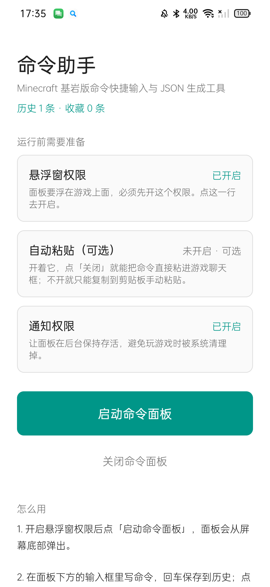
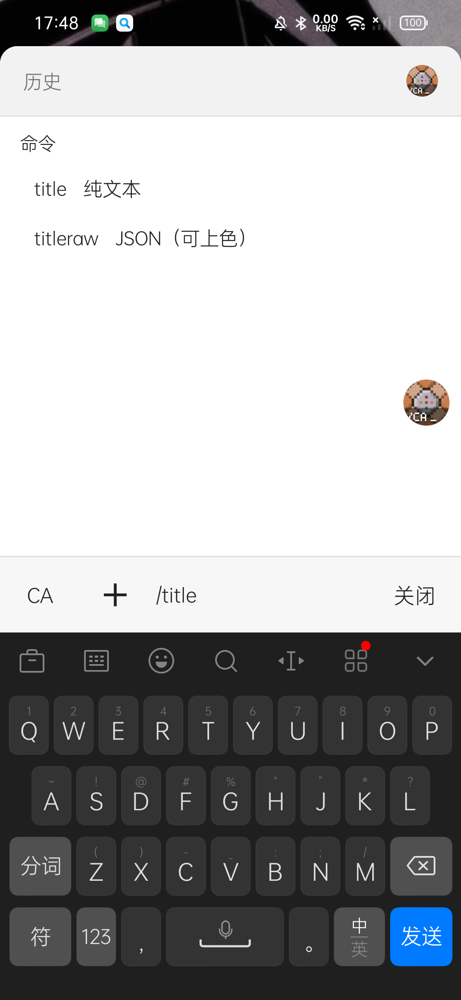

# 命令助手 · 重制版

> Minecraft 基岩版命令的**中文补全 / JSON 生成**工具（安卓悬浮窗）。
> 这是 [xero 的「命令助手」](https://github.com/) 的重制版 —— 原版已停更且不适配安卓 16。

[](https://github.com/dscntoxanan/Minecraft-Be-Command-Helper)
[](LICENSE)

下载：<https://xanan.top/net/helper/>

<p align="center">
  
  
</p>

---

## 它解决什么

基岩版命令的痛点是**记不住**：

- 物品/方块 ID 是英文，中文玩家要边查 wiki 边拼；
- `titleraw`、`tellraw`、`give` 的 JSON 参数层层嵌套，`/give @s diamond_sword` 后面接
  `{"enchantments":[...]}` 这种，手写极易出错；
- 写完还要切回游戏、打开聊天框、粘贴、回车。

这个工具做三件事：**中文搜索 ID**、**表单化生成 JSON**、**悬浮窗里直接拼完粘进游戏**。

---

## 功能

| 功能 | 说明 |
|---|---|
| **中文补全** | 打「钻石」「羊毛」「原木」就能搜到对应 ID，插入的仍然是英文 ID |
| **124 条命令** | 覆盖原版基岩版命令，含多词子命令（`scoreboard players set` 等） |
| **JSON 逐层补全** | `titleraw` / `tellraw` / `give` 的 JSON 参数按层给出候选，不会写错括号 |
| **选择器语法** | `@e[type=zombie,r=10]` 里的参数与值都能补 |
| **物品组件** | `give` 的 `{"enchantments":...}` 提供速插模板 |
| **玩家指令库** | 15 条常用玩法模板（一键出整套命令） |
| **键盘避让** | 打字时面板自动抬到输入法上方，输入栏不会被挡住 |
| **命令族选择** | 打 `/title` 会先问你要 `title`（纯文本）还是 `titleraw`（JSON 可上色） |
| **自动粘贴** | 无障碍服务直连游戏聊天框，点「关闭」即发送 |

词表规模：物品 558 / 方块 1142 / 实体 142 / 音效 1671 / 粒子 192，
另有「能 `/give` 的全部 ID」合集 1667 条（基岩版方块也能 `/give`）。

---

## 数据从哪来

词表**不是手抄的**，全部由 `tools/` 下的脚本从官方数据源生成：

| 源 | 用途 |
|---|---|
| Mojang `bedrock-samples` 的 `zh_CN.lang` | 中文译名的唯一权威 |
| Microsoft Learn 的 `Items.md` / `Blocks.md` | 官方认可的 ID 清单 |
| `sound_definitions.json`、`resource_pack/particles` | 音效与粒子 ID |

三源交叉核对，冲突时以 `zh_CN.lang` 为准（它对游戏版本最敏感）。
官方文档里存在**旧 ID 未更新**的情况（例如它写 `silver_glazed_terracotta`，
而现代游戏是 `light_gray_glazed_terracotta`）。

> ⚠️ `zh_CN.lang` **不在本仓库内**（版权归 Mojang）。需要时运行
> `tools/suggest/fetch-lang.mjs` 自行下载。

### 重新生成词表 / 命令库

```bash
node tools/suggest/fetch-lang.mjs        # 下载官方语言文件（联网）
node tools/suggest/build-terms.mjs       # 重建 items.csv / blocks.csv
node tools/suggest/gen-extra-terms.mjs   # 音效 / 粒子表
node tools/suggest/gen-suggest.mjs       # 生成 Suggest.kt 与 4 张大表
node tools/commands/gen-commands.mjs     # 生成 CommandLibrary.kt
```

`Suggest*.kt` 与 `CommandLibrary.kt` 是**生成文件**，不要手改 —— 下次生成会覆盖。

---

## 编译

**环境**：JDK 17+、Android SDK（`compileSdk 37` / `targetSdk 36` / `minSdk 24`）

```bash
# 先在 local.properties 里写 sdk.dir=<你的 Android SDK 路径>
./gradlew :app:assembleDebug
```

正式包需要自己的签名：

```bash
./gradlew :app:assembleRelease     # 未配签名时产出未签名包
```

签名配置不写死在仓库里。本项目按「口令放仓库外」的约定读取
`%USERPROFILE%\.dsh\wsx-signing.env`（或根目录 `keystore.properties`）：

```properties
STORE_FILE=path/to/your.jks
STORE_PASSWORD=***
KEY_ALIAS=***
KEY_PASSWORD=***
```

没有这两份文件时 release 仍能编译，只是不签名。

### 测试

```bash
./gradlew :app:testDebugUnitTest
```

219+ 个单元测试覆盖补全引擎、JSON 解析、选择器、命令拼装、词表覆盖度。

---

## 技术要点（几个反直觉的地方）

- **悬浮窗里不能弹 `AlertDialog`**：`show()` 会抛 `BadTokenException` 直接杀掉进程，
  所以所有对话框都是面板窗口内部的普通 View。
- **`isAttachedToWindow` 在悬浮窗里永远是 `false`**，不能拿它判断状态。
- **JVM 单方法 64KB 上限**：词表涨到 3700 条会触发
  `Method too large: Suggest.<clinit>`。Kotlin 把同一文件所有顶层属性编进一个
  `<clinit>`，所以大表必须拆到**独立文件**（`SuggestItems.kt` 等），
  同文件里拆多个 `val` 没用。
- **键盘避让要自己算**：`TYPE_APPLICATION_OVERLAY` 不参与 `adjustResize`，
  系统既不会缩窗口也不会推窗口。要自己量键盘高度再抬窗口，
  且窗口高度必须按**实测可用区域**算（比屏幕高少一截状态栏）。

---

## 目录结构

```
app/src/main/java/com/xanan/cmdhelper/
  json/      命令库 + 补全引擎 + 词表（核心）
  ui/        悬浮面板、补全列表、各对话框
  service/   悬浮窗服务、无障碍自动粘贴
  data/      历史记录、设置持久化
  util/      剪贴板、键盘监听
tools/
  commands/  命令库生成器与数据表
  suggest/   词表生成器、官方数据抓取、审计脚本
```

---

## 许可

代码以 [MIT](LICENSE) 许可开源。

**不包含**：Mojang 的游戏资源（`zh_CN.lang`、音效名等衍生数据由脚本从官方源获取）。
「Minecraft」是 Mojang Studios 的商标，本项目与其无关联。

---

## 致谢

- 原版「命令助手」作者 **xero** —— UI 风格与交互设计源自原版
- [smali/dexlib2](https://github.com/google/smali)、[AndroidX](https://developer.android.com/jetpack)
